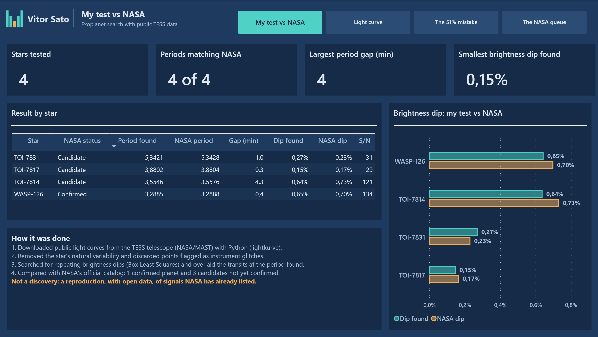
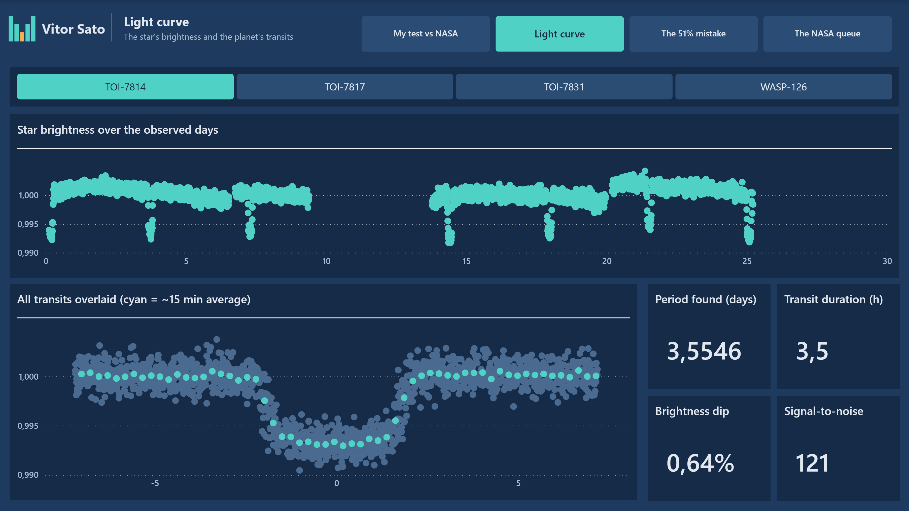
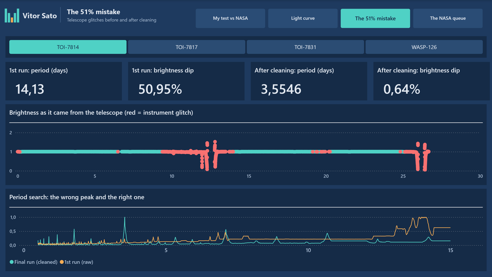
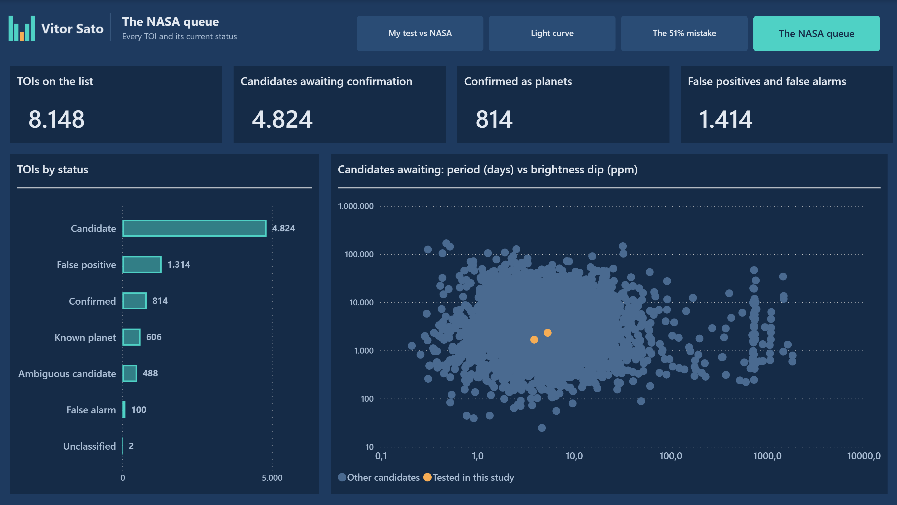

# Exoplanet study — Can I find a planet with public NASA data?

**Power BI · DAX · Power Query · Python (real public data)**
Personal study by **Vitor Sato** — Power BI & data analysis.



> All data comes from **public NASA sources**: TESS light curves from the MAST archive and the NASA Exoplanet Archive catalog. This is **not a discovery**: it reproduces, with open data, signals NASA has already listed.

## Why this project

In October 2026 a post went viral about a person with no astronomy background who found an exoplanet candidate using an AI coding assistant on public data from NASA's TESS telescope. I wanted to know how far a data analyst gets with the same open data, and where it goes wrong.

The questions:

1. **Can I find the period of a known planet** using only the star's brightness over time?
2. **Does the same method work on candidates NASA has not confirmed yet?**
3. **Where does it break?** What does the raw data hide that a quick analysis would miss?

## What the dashboard shows

| Page | Question it answers |
|---|---|
| **My test vs NASA** | Did my numbers match the official catalog? Period, transit depth and signal-to-noise for each star, side by side with NASA |
| **Light curve** | What does a planet look like in the data? The star's brightness over the days, and every transit overlaid into a single dip |
| **The 51% mistake** | What went wrong on the first try? Instrument glitches in red, and the period search before and after cleaning |
| **The NASA queue** | How many candidates are waiting? All 8,148 TOIs by status, with the 3 I tested highlighted |

### What I learned

- **4 out of 4 periods matched NASA**, with a largest gap of 4 minutes. For the confirmed planet WASP-126 b: 3.2885 days found vs 3.2888 official, from 27 days of observation.
- **A 0.15% dip is invisible in the raw data** (TOI-7817) and obvious once the transits are overlaid. Same idea as averaging noisy daily numbers to see a trend.
- **The first run was wrong.** Two of the three candidates pointed to a 14-day period, and one to a 51% brightness drop. It was scattered light hitting the telescope before data downlinks, in a source delivered without cleaning. Dropping the points flagged as bad fixed it. Without looking at the chart I would have reported a planet that does not exist.
- **4,824 candidates are still waiting for confirmation**, and 1,414 TOIs have already turned out to be false positives or false alarms.

| | |
|---|---|
|  |  |
|  | |

## How it was built

### Data (Python)
`dados/gerar_dados.py` downloads the light curves with [lightkurve](https://docs.lightkurve.org/) (up to 3 TESS sectors per star), finds the period with **Box Least Squares**, compares it with the NASA Exoplanet Archive and writes 5 CSV files. The method:

- Normalize the brightness and remove the star's slow variability.
- Search for repeating dips from 0.5 to 15 days; second pass protects the dips found and refines the period within ±1%.
- **1st run** on the data as delivered; **final run** with the strict quality filter and without points that change brightness by more than 5% (no planet does that).

Run it with `python dados/gerar_dados.py <cache_folder> dados`.

### Power Query (M)
- CSVs read from a single folder parameter, typed with an explicit culture.
- Index columns so each measurement is its own point on the scatter charts.
- Portuguese and English label columns (status, point quality, series), so the same model serves both report versions.

### Data model
One dimension (`Estrelas`, one row per star with my result and NASA's) related to three fact tables (raw light curve, overlaid transits, period search), plus the full TOI list. Built as **TMDL generated by a Python script** (`modelo/gerar_modelo.py`), with stable lineage tags.

### Key DAX measures
- **Periods matching NASA**: stars whose period differs from the official one by less than 1%.
- **Period gap in minutes** per star and the largest gap overall.
- **Measure-driven colour**: red for instrument glitches, cyan for the 15-minute average over grey measurements.
- One measure per series on the period-search chart (1st run vs final run), with `KEEPFILTERS`.

### Report
Same custom dark theme as my other portfolio projects, 4 pages with page navigation and a star selector that always keeps one star selected. Portuguese and English versions of the same report on one shared semantic model, plus a hidden documentation page with the business rules and change history. Built as a **PBIP project (TMDL + PBIR)** and versioned in git.

## Repository structure

```
dados/                          Python script + generated CSV files
modelo/                         Python script that writes the semantic model (TMDL)
Exoplanetas.SemanticModel/      semantic model (TMDL)
Estudo-exoplanetas.Report/      report, Portuguese
Exoplanet-study-EN.Report/      report, English
prints/                         screenshots (en/, pt/)
```

## How to open it

1. Install Power BI Desktop (free).
2. Clone this repository.
3. Open `Exoplanet-study-EN.pbip` (English) or `Estudo-exoplanetas.pbip` (Portuguese).
4. If asked, set the parameter `CaminhoDados` to the full path of the `dados/` folder and click **Refresh**.

## Limits

- It reproduces signals NASA has already listed; it does not rule out false positives such as eclipsing binary stars.
- Numbers use the Brazilian format (comma as decimal separator) in both versions, because they share one semantic model.
- The candidate scatter samples its points, so one of the 3 tested stars may be hidden behind others.

## About me

Data analyst in São Paulo, Brazil. Before data, I spent years implementing systems and running projects with clients across many industries (manufacturing, construction, healthcare, logistics and energy), so I start from the process and only then build the metrics.

Portfolio website: https://portfolio-vitor-sato.vercel.app

- LinkedIn: [linkedin.com/in/vitorsato](https://www.linkedin.com/in/vitorsato)
- E-mail: vitorsato@icloud.com
